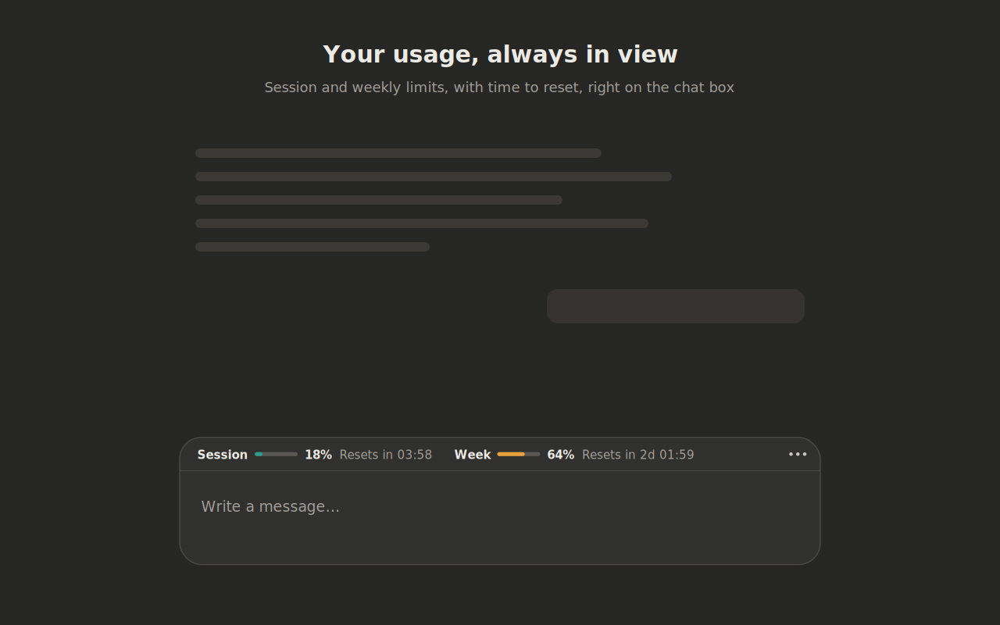

# Usage Counter for Claude

A Chrome extension that shows your Claude usage limits in a slim line on top of the claude.ai chat box.

## What it shows

- **On the line:** session and weekly usage as percentages, plus per-model weekly limits when your plan has them.
- **In the ⋯ menu:** when each limit resets, how much your last reply used, extra usage credits, and an Update now button.
- **Alerts (optional):** notifications at 80%, 90%, when you hit a limit, and when a limit resets.

## Privacy

The extension talks only to claude.ai, using the login you already have. It never reads, stores or sends your messages, has no servers and no analytics, and keeps everything in your browser. Read the full [privacy policy](https://Pinak0910.github.io/usage-counter-for-claude/privacy/).

## Install

- **From the Chrome Web Store:** link coming soon.
- **From a release:** download the latest `usage-counter-for-claude-v….zip` from [Releases](https://github.com/Pinak0910/usage-counter-for-claude/releases), unzip it, open `chrome://extensions`, turn on Developer mode, click **Load unpacked**, and select the unzipped folder.
- **From source:** clone this repository and load the `extension` folder the same way.

## Repository layout

| Path | What it is |
| --- | --- |
| `extension/` | The extension itself, exactly as uploaded to the Chrome Web Store |
| `privacy/index.html` | The privacy policy, served by GitHub Pages |
| `index.html` | The project homepage, served by GitHub Pages |
| `images/` | Store icon, promo tiles and screenshots |
| `.github/workflows/release.yml` | Attaches an installable zip to every release you publish |

## How it works

The extension reads your usage from the same claude.ai endpoint the Usage page in Settings uses. It updates when you open the page, when a reply finishes, when you return to the tab, or when you press Update now. It never polls on a timer. That endpoint is not a public API, so a claude.ai change can stop the numbers from loading; the line then shows a plain message instead of breaking.

## License

[MIT](LICENSE). See the [changelog](CHANGELOG.md) for what changed in each version.

## Disclaimer

Independent project, not affiliated with or endorsed by Anthropic. Claude is a trademark of Anthropic.
